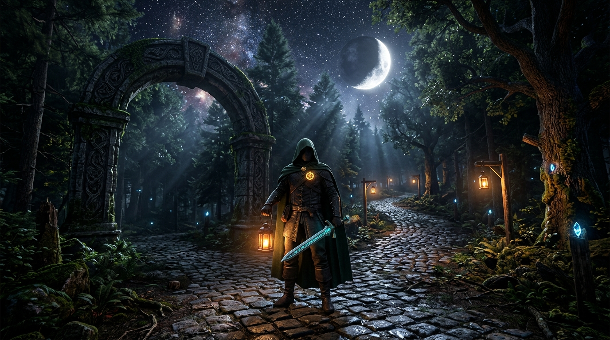
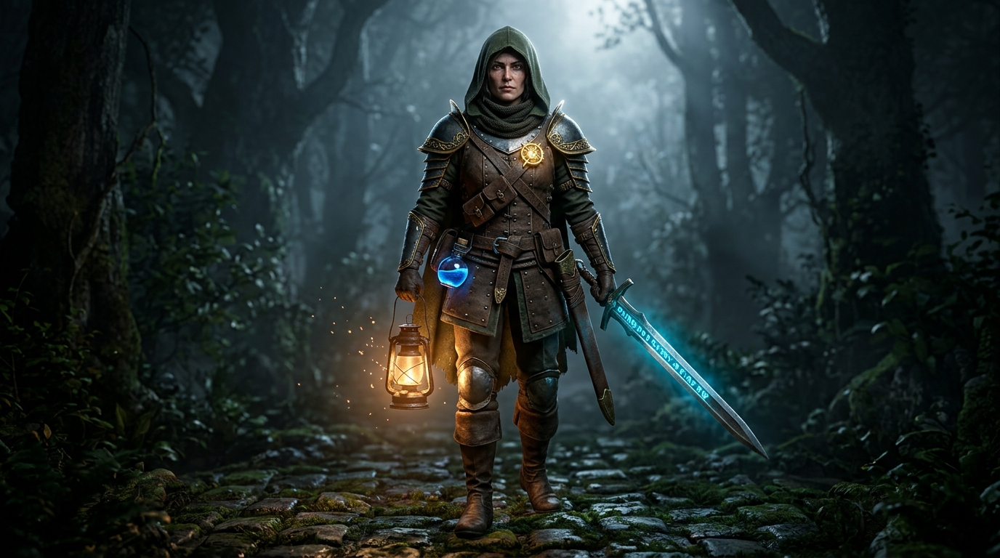
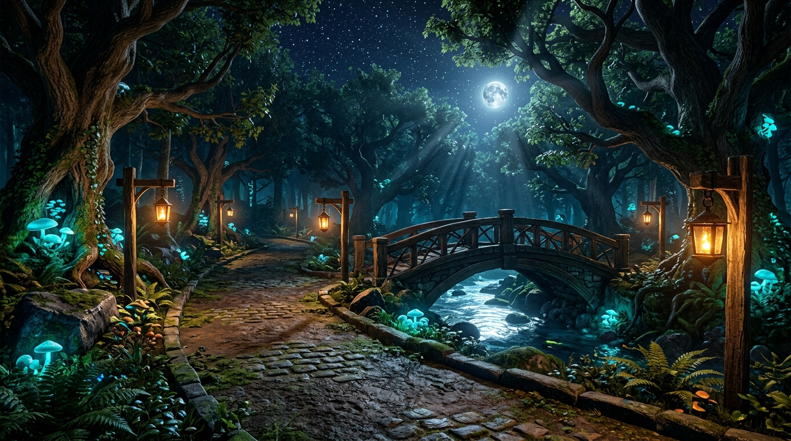
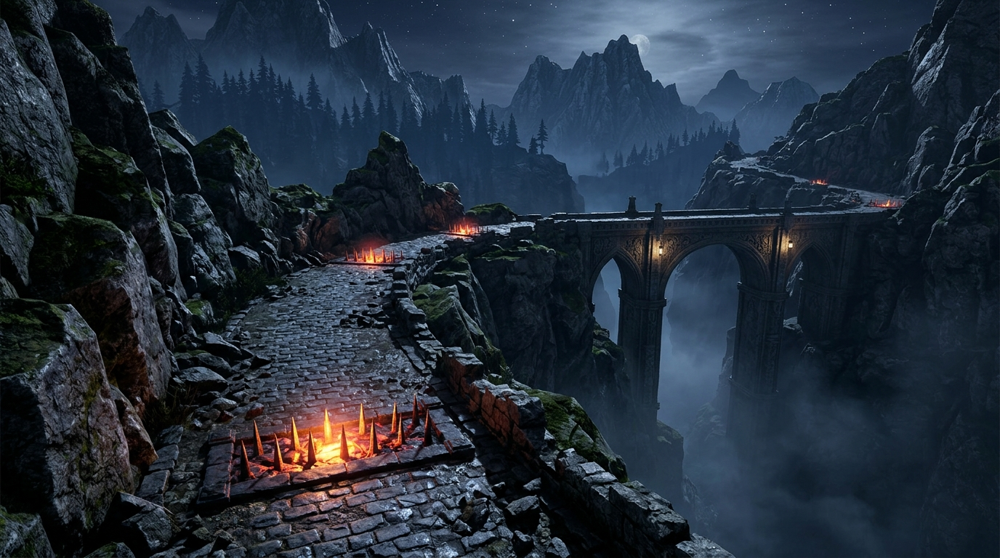
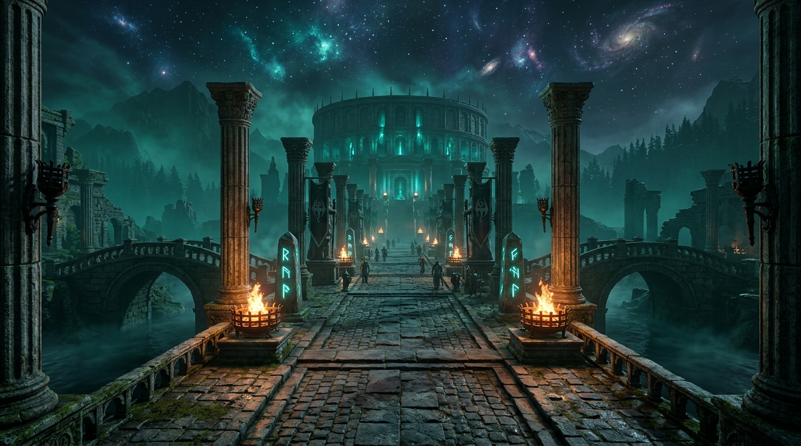
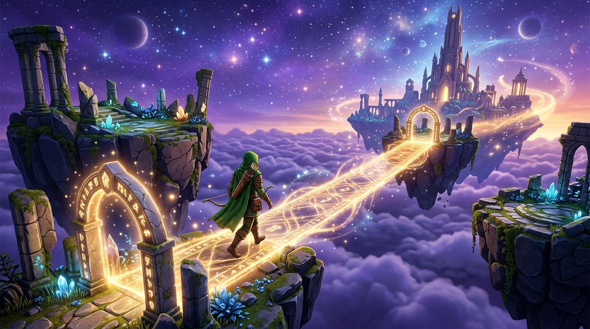
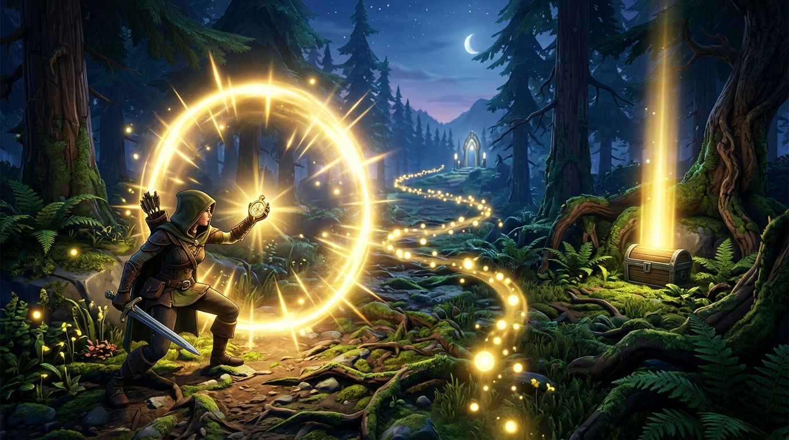
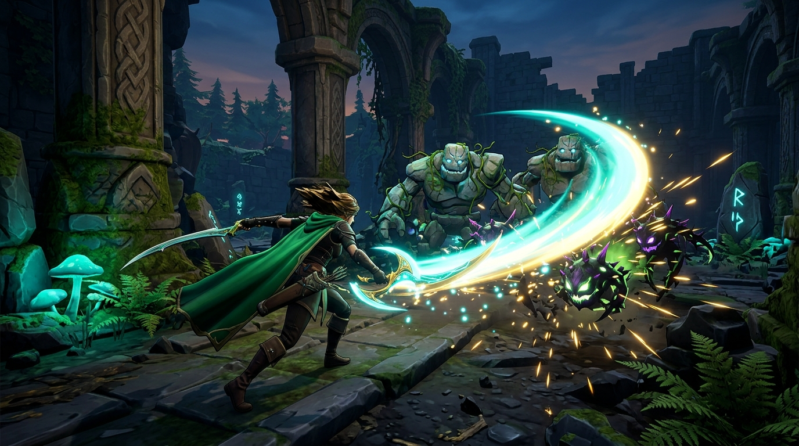
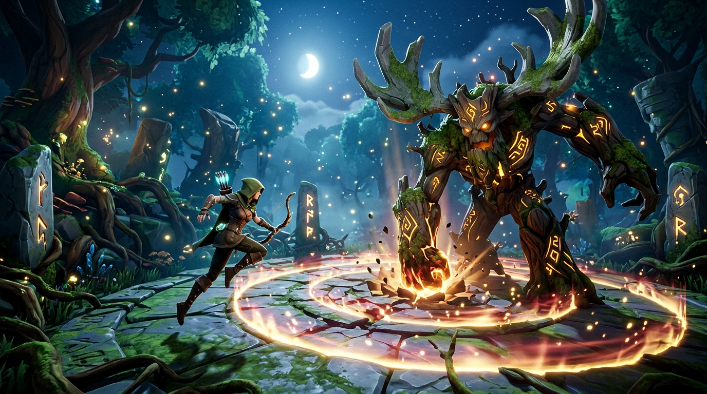
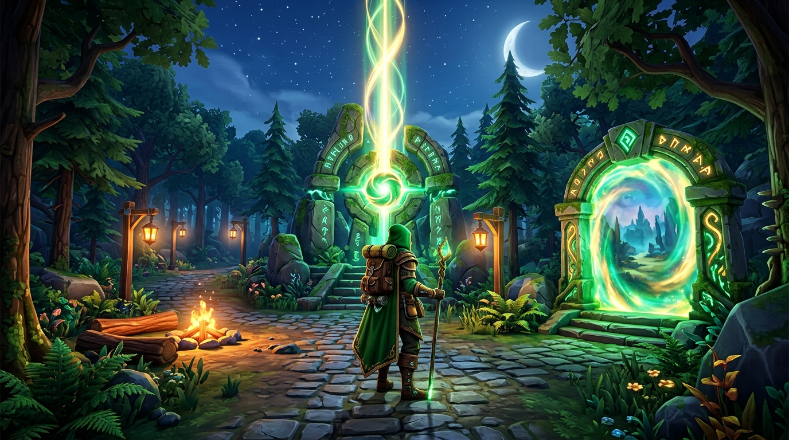

# Magical Forest: The Golden Compass

> **A 3D fantasy action-adventure built purely in Godot 4 (GDScript & WebGL2). Wield the Golden Compass to illuminate hidden paths across four enchanted realms, awaken Ancient Wayshrines, survive deadly forest traps, and defeat the guardians of the corrupted woods.**



---

## Overview

Step into an enchanted twilight wilderness in **Magical Forest: The Golden Compass** — a third-person 3D fantasy action-adventure crafted 100% in pure **Godot 4 (GDScript-only)** with the **`gl_compatibility` (WebGL2)** renderer.

Playing as a lone Explorer armed with a Rune Broadsword, wrought-iron lantern, and a mystical rotating **Golden Compass** brooch, you must journey across four handcrafted procedural 3D stages to restore balance to the forest. Trigger the **Golden Compass Pulse (`G`)** to emit a radiant shockwave across the world — sending glowing firefly orbs toward your active quest objective, revealing hidden treasure chests, shards, traps, and lore runestones, solidifying hidden celestial bridges, and shattering the final boss's astral shield.

---

## Visual Showcase

### 1. The Woodland Explorer & Golden Compass Brooch
*Anatomically sculpted dark-fantasy ranger clad in a physics-reactive emerald cloak, brigandine leather, glowing Rune Broadsword, and a live rotating Golden Compass brooch.*



### 2. Stage 1 — Whispering Moss Woods
*Explore a full `220m × 220m` moonlit valley lined with pine and oak groves, Elder Sylvan's trailhead campfire, ancient stone archways, Sunlit Shards, hidden glade chests, and the first Ancient Wayshrine.*



### 3. Stage 2 — Thornhollow Ancient Ruins
*Navigate misty overgrown courtyards, decipher Lore Runestones for the Wandering Cartographer, awaken three Ancient Rune Pillars, evade timed thorn traps, and defeat Corrupted Stone Golems.*



### 4. Stage 3 — Heart of the Grove
*Cross the twilight monolith causeway, consult the Grove Spirit, ignite the pre-boss Wayshrine, and enter the circular boss sanctum.*



### 5. Stage 4 — Astral Canopy Sanctuary
*Traverse floating starlit islands high above the twilight clouds by materializing hidden celestial light bridges with your awakened Golden Compass.*



### 6. The Golden Compass Pulse Mechanic
*Press **`G`** to unleash a golden shockwave ring, guide 16 glowing firefly trail orbs straight toward your active objective, and illuminate hidden chests, shards, runestones, and traps within 45 meters.*



### 7. Third-Person Melee & Golden Compass Arc Combat
*Chain a 3-hit Rune Blade melee combo with hit-stop and knockback, evade with invulnerability dashes, and launch ranged **Golden Compass Arc** crescent waves (`Right Click` / `K`).*



### 8. Multi-Phase Boss Encounters
*Battle **Vaelthorn, Corrupted Forest Guardian** (Stage 3 — 3 escalating phases with thorn waves, jumpable shockwave rings, summoned stalkers, and spore meteors) and **Aurelius, the Astral Sovereign** (Stage 4 — shatter his Astral Aegis Shield using Compass Pulse `[G]`).*



### 9. Ancient Wayshrines, Checkpoints & Realm Portals
*Awaken sky-piercing Ancient Wayshrines to restore full vitality and save your respawn checkpoint, then unseal swirling emerald-and-gold Realm Portals to advance across all four stages.*



---

## Key Features

- **Golden Compass Mechanic (`G`)**:
  - Live top-center HUD compass needle + real-time integer distance (`m`) to your active quest objective, plus the live rotating compass brooch on the Explorer's chest.
  - Emits an expanding golden shockwave + **16 glowing golden firefly orbs** flowing toward the next objective.
  - Highlights hidden treasure chests, Sunlit Shards, Lore Runestones, Rune Pillars, and deadly traps for 10 seconds.
  - Materializes hidden **Astral Light Bridges** in Stage 4 and shatters **Aurelius's Astral Aegis Shield** in the final battle.
- **Full 4-Stage RPG Campaign & Quest System (`QuestManager`)**:
  - **Stage 1 — Whispering Moss Woods**: Main Quest *Awaken the Golden Path* + Side Quest *Lost Lantern Relics* (`+1 Max Vitality` & `+1 Healing Herb`).
  - **Stage 2 — Thornhollow Ancient Ruins**: Main Quest *Seals of Thornhollow* + Side Quest *Cartographer's Lost Notes* (`+6 Attack Power`).
  - **Stage 3 — Heart of the Grove**: Main Quest *Heart of the Grove* + Multi-Phase Boss **Vaelthorn, Corrupted Forest Guardian**.
  - **Stage 4 — Astral Canopy Sanctuary**: Main Quest *Crown of the Golden Compass* + Final Boss **Aurelius, the Astral Sovereign** & Victory Summary.
  - Complete **Story NPC Dialogue Box** (typewriter reveal), live **HUD Quest Tracker**, and toggleable **Quest Journal (`Q` / `Tab`)**.
- **Responsive Third-Person Exploration & Combat**:
  - Smooth mouse-orbit camera with `SpringArm3D` terrain/wall collision avoidance and scroll-wheel zoom.
  - Jump + Double Jump with coyote time and jump buffering, Shift Evade Dash with i-frames and FOV kick, 3-Hit Melee Combo (`LMB` / `J`), Ranged Golden Compass Arc (`RMB` / `K`), and Healing Herbs (`H`).
  - 4 distinct enemy types (**Moss Stalker**, **Thorn Spitter**, **Corrupted Stone Golem**, **Astral Wraith**) + 2 multi-phase bosses.
- **100% Pure Godot 4 & WebGL2-Safe**:
  - Deterministic mathematical heightmap terrain (`get_terrain_height(x, z)`) with accurate `StaticBody3D` trimesh colliders and `MultiMeshInstance3D` forests running smoothly at 60 FPS in `gl_compatibility`.
  - Built-in procedural `AudioManager` synthesizing 21 crisp `AudioStreamWAV` sound effects and ambient twilight wind directly at runtime — zero external asset failures.

---

## Controls

| Action | Key / Input |
|---|---|
| **Move Explorer** | `W` `A` `S` `D` or `Arrow Keys` |
| **Orbit Camera & Zoom** | `Mouse Move` / `Mouse Wheel` |
| **Jump & Double Jump** | `Space` |
| **Evade Dash (i-frames)** | `Shift` |
| **3-Hit Melee Combo** | `Left Click` or `J` |
| **Golden Compass Arc (Ranged, 25 Energy)** | `Right Click` or `K` |
| **Golden Compass Pulse (Trail & Secrets)** | `G` |
| **Interact (NPCs, Chests, Shrines, Pillars, Portals)** | `E` |
| **Use Healing Herb (+2 Vitality)** | `H` |
| **Quest Journal** | `Q` or `Tab` |
| **Pause Menu & Audio Settings** | `Esc` |

---

## How to Play (Godot 4 Desktop & Web Editor)

This project is a **100% pure Godot 4 project** (`project.godot` + GDScript + `.tscn`/`.tres`/`.gdshader`) with zero Node.js or external runtime dependencies.

### Option A: Godot 4 Web Editor (No Install Needed)
1. Download or ZIP this repository folder.
2. Open the official **Godot 4 Web Editor** at [https://editor.godotengine.org/releases/latest/](https://editor.godotengine.org/releases/latest/).
3. Click **Start Godot editor**, import the project ZIP (or `project.godot`), and press **Play (`F5`)**.

### Option B: Godot 4 Desktop (Recommended)
1. Install **Godot 4.2+** (Standard Edition, GDScript).
2. Open the Godot Project Manager, click **Import**, and select `project.godot`.
3. Press **`F5`** to launch from the live 3D Twilight Forest Main Menu (`res://scenes/ui/main_menu_3d.tscn`).

---

## Project Architecture

```text
MagicalForestGoldenCompass/
├── project.godot                      # Godot 4 gl_compatibility config, Autoloads & InputMap
├── autoloads/
│   ├── game_manager.gd                # Persisted RPG stats, checkpoints, upgrades & scene flow
│   ├── quest_manager.gd               # 4-stage Main/Side Quest engine & live compass targeting
│   └── audio_manager.gd               # Procedural WebGL2-safe AudioStreamWAV SFX & ambience
├── scenes/
│   ├── player/
│   │   ├── player_3d.tscn / .gd       # Explorer controller, combat, dash, interact & Compass Pulse
│   │   ├── player_visuals_3d.gd       # Layered dark-fantasy ranger equipment & compass brooch
│   │   └── golden_arc_3d.gd           # Ranged Golden Compass Arc crescent wave projectile
│   ├── levels/
│   │   ├── level_builder_3d.gd        # Deterministic 220m sculpted terrain, MultiMesh forest & stages
│   │   ├── level_1_3d.tscn            # Stage 1 — Whispering Moss Woods
│   │   ├── level_2_3d.tscn            # Stage 2 — Thornhollow Ancient Ruins
│   │   ├── level_3_boss_3d.tscn       # Stage 3 — Heart of the Grove (Vaelthorn Boss)
│   │   └── level_4_astral_3d.tscn     # Stage 4 — Astral Canopy Sanctuary (Aurelius Boss)
│   ├── world/                         # NPCs, Wayshrines, Portals, Chests, Shards, Pillars, Bridges, Traps
│   ├── enemies/                       # Base AI, Stalker, Spitter, Golem, Wraith & 2 Multi-Phase Bosses
│   └── ui/
│       ├── main_menu_3d.tscn / .gd    # Live 3D twilight clearing menu, Stage Select, Guide & Audio
│       ├── hud.tscn / .gd             # Full RPG HUD, live Compass, Quest Tracker, Journal & Modals
│       └── dialogue_box.gd            # Typewriter story dialogue box
├── resources/                         # Shaders, PBR materials, fonts, audio bus layout & environment
└── assets/
    └── showcase/                      # 10 showcase images embedded in README.md (.gdignore excluded)
```
